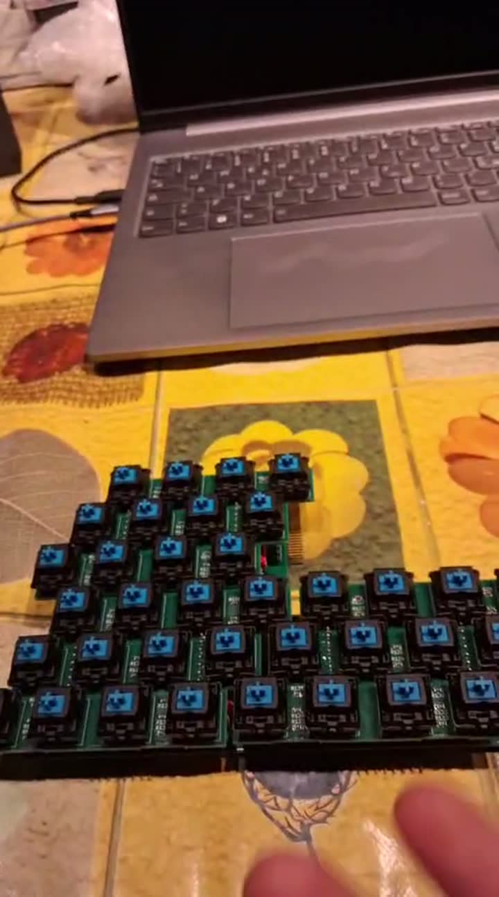

# Isomorphic keyboard

An open-source, **modular isomorphic keyboard**. The instrument is built from identical
12-key tiles arranged in supported column-based grids. A pico-ice (Lattice iCE40UP5K)
rediscovers the arrangement on every scan and plays it over **MIDI**. Tiles can be added,
removed and moved while playing.



## Status

- **rev A** (tag `rev-a-prototype`): working prototype. Double-stack tiles (key board over
  logic board), hot-plug, automatic above/below/beside detection, MIDI DIN output.
- **Current development:** a single-PCB tile with Cherry-MX-style SMD hot-swap
  sockets, a practical equilateral lattice and chassis-supported drop-in contacts.
  The **tiny FPGA is the lead implementation**, with discrete logic retained as
  the no-programmer reference and alternative. Target: 20 MHz shift clock,
  up to 16 tiles; no tile-side MCU, LEDs or Hall sensing.
- **rev B** (reference commit `d358953`): termination, decoupling and assembly
  studies for the earlier double-board design; not hardware-tested.

The project is consolidated into this one directory. Start with the
[current status](docs/architecture/current-development.md) and
[consolidation record](docs/CONSOLIDATION.md). The FPGA/controller tests have
advanced, but the new tile is not yet a routed, hardware-validated release.

## Repository layout

| Path | Content |
|---|---|
| `docs/` | documentation: [index](docs/index.md), [engineering ledger](docs/LEDGER.md) |
| `hardware/experiments/simple-tile/fpga/` | active FPGA RTL, chain tests and board prototype |
| `hardware/experiments/simple-tile/discrete-spld/` | discrete baseline; SPLD comparison retained as reference |
| `hardware/experiments/simple-tile/connector-next/` | current chassis-contact and tiling study |
| `hardware/kicad/tile/` | reference KiCad key board + logic board |
| `hardware/simulation/` | behavioural VHDL model of a tile and grid testbenches |
| `hardware/fabrication/rev-a/` | gerbers and BOM of the manufactured rev-A boards |
| `firmware/ice40/` | controller firmware (VHDL) for the pico-ice |
| `firmware/ice40/scan20/` | isolated 20 MHz / 16-tile scan-engine test fixture |
| `firmware/experiments/` | earlier bring-up designs, kept for reference |
| `tools/` | rootless container recipes, `kicad-cli` / OSS CAD Suite wrappers, check scripts |
| `LICENSES/` | full license texts |

## Quick start

Current development checks, from the repository root:

```sh
bash hardware/experiments/simple-tile/fpga/sim/run_sims.sh
bash firmware/ice40/scan20/sim/run_sims.sh
```

The following commands build/open the earlier reference implementation:

```sh
# firmware (rootless podman)
podman build -t localhost/oss-cad-suite:2026-09-26 tools/containers/oss-cad-suite
cd firmware/ice40 && ../../tools/oss.sh make && make upload-flash

# hardware
flatpak install --user flathub org.kicad.KiCad
flatpak run org.kicad.KiCad hardware/kicad/tile/isomorphic_tile.kicad_pro
```

See [docs/build/firmware.md](docs/build/firmware.md) and
[docs/build/hardware.md](docs/build/hardware.md).

## Licenses

| Part | License |
|---|---|
| Hardware (`hardware/`) | CERN-OHL-S v2 |
| Firmware and tools (`firmware/`, `tools/`) | GPL-3.0 |
| Documentation (`docs/`) | CC BY 4.0 |
| Vendored Open Logic subset (`firmware/ice40/src/open-logic/`) | PSI HDL Library License 1.0 |

Full texts are in `LICENSES/`. Each top-level folder has its own `LICENSE.md`.

© Orturano Labs
